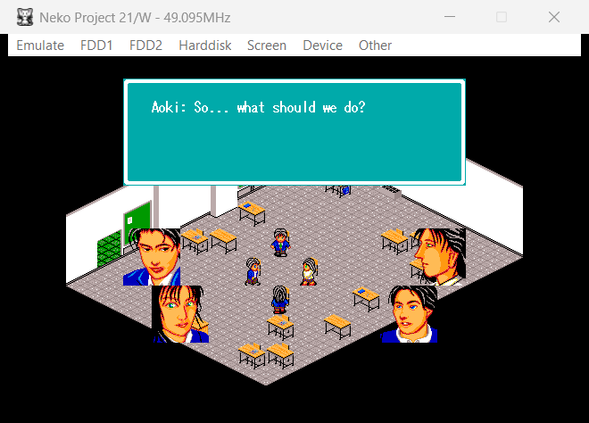

# After School Ghosts (放課後の幽霊達) — English Translation

A 1990s Japanese PC-98 horror RPG, now playable in English on Windows.

*After School Ghosts* (*Hōkago no Yūreitachi*) was made with DANTE98 by Yuji Watanabe and
released on the *Login Sofcom No.4* CD-ROM. Four students stay late to plan their school
festival and find out why their school on the mountain has always been "haunted".

## Credits

| | |
|---|---|
| **Yuji Watanabe** | Creator of *After School Ghosts* |
| **MarshSMT** and **VmigoStation** | Led the effort to preserve this game |
| **Neko Project 21/W** developers | The PC-98 emulator that runs it (licences in `np21w-0.86-rev100/LICENSES/` in the download) |

## ⬇ [Download the game for Windows](https://github.com/BruTalc/After-School-Ghosts-English-/releases/latest/download/After-School-Ghosts-English.zip)

**Everything you need is in this one download:** the game, the PC-98 emulator, and a launcher.
There is nothing else to install. Then follow the three steps below.

---

## How to play on Windows

### Step 1: Download the game

1. Click **[Download the game for Windows](https://github.com/BruTalc/After-School-Ghosts-English-/releases/latest/download/After-School-Ghosts-English.zip)**.
   Your browser saves **`After-School-Ghosts-English.zip`** (about 230 MB) to your **Downloads** folder.
2. If that link doesn't work, go to the **[Releases page](../../releases/latest)**, scroll down to
   **Assets**, and click **`After-School-Ghosts-English.zip`** there.

> [!WARNING]
> **Do not use the green `<> Code` button or "Download ZIP" on this page.** That only gives you
> the translation's source files, not the game. You won't be able to play it. Always download
> **`After-School-Ghosts-English.zip`** from the [Releases page](../../releases/latest).

### Step 2: Unzip it

1. Open your **Downloads** folder.
2. **Right-click** `After-School-Ghosts-English.zip` and choose **Extract All…**
3. Click **Extract**. A new folder opens with the game in it.

> [!IMPORTANT]
> If you just double-click the zip, Windows shows the files *inside* the zip, but the game
> **won't run from there**. Extract it first, as above.

### Step 3: Start the game

1. In the extracted folder, **double-click `Play After School Ghosts`**.
   * If you only see another folder, open it. Keep going until you see `Play After School Ghosts`.
   * Windows may show the file as **`Play After School Ghosts.cmd`**, with the type
     *Windows Command Script*. That's the right file.
2. **If Windows shows a warning** (it may, the first time, because the file came from the internet):
   * *"Open File – Security Warning"*: click **Run**.
   * *"Windows protected your PC"*: click **More info**, then **Run anyway**.
3. The game starts by itself after a few seconds. You don't need to type any commands.

**That's it.** Next time, just double-click `Play After School Ghosts` again.

### Controls

| Key | What it does |
|---|---|
| Arrow keys | Walk, move the cursor |
| Enter | Confirm, talk, advance text |
| Esc | Open the menu, cancel |

**To save,** press Esc and choose **System → Save Game**.

**To change the window size,** right-click the emulator's title bar and pick a size, such as
`1280x800(x2)`. The first time you play, the window is sized to fit your screen automatically.
For fullscreen, use **Screen → Fullscreen**.

### Something went wrong?

| What you see | What to do |
|---|---|
| A message saying the game is being run from inside the zip | Go back to [Step 2](#step-2-unzip-it) and use **Extract All…** |
| "The game disk image is missing" or "The emulator is missing" | Some files didn't get extracted. Delete the folder and extract the zip again. Keep all the files together. |
| "Could not save the emulator settings" | Move the whole game folder somewhere like **Documents** or the **Desktop**, then try again. |
| "The game is already running" | Look on your taskbar for the *Neko Project 21/W* window. |
| A black or blank emulator screen | Close the emulator and double-click `Play After School Ghosts` again. |

**Mac or Linux?** Only Windows is supported right now.

---

## About the translation

This is an unofficial fan translation. The English text is a machine-assisted first draft that
**has not yet been reviewed by a native Japanese speaker**. All dialogue, menus, battle
messages and names are translated. The title-screen logo and the save-slot labels are still
in Japanese. Expect some rough edges. Corrections are very welcome.

---

## For contributors

This repository holds the translation and the tools that build it. The game itself is not
stored here.

| Folder | What's in it |
|---|---|
| [`ghost-en/script/`](ghost-en/script/) | The translation, as `.po` text files. This is the only thing translators need to edit. |
| [`ghost-en/tools/`](ghost-en/tools/) | The build tools (Python 3, standard library only). |
| [`ghost-en/docs/`](ghost-en/docs/) | File formats and how the game engine draws text. |
| [`launcher/`](launcher/) | The Windows launcher and the default emulator settings. |
| [`Play After School Ghosts.cmd`](Play%20After%20School%20Ghosts.cmd) | What players double-click. |

To edit the translation and rebuild the game, start with
**[ghost-en/README.md](ghost-en/README.md)**. You need a copy of the release download, because
the disk image and the original game files are not in this repository.

### Making a release

1. Rebuild the game: `python tools/ghost.py all`, run from the `ghost-en` folder.
2. Put a clean copy of the emulator settings in place by copying
   `launcher/np21w.default.ini` over `np21w-0.86-rev100/np21w.ini`. Your own copy has
   your saved window size and position in it.
3. Zip these items **at the top level of the zip, not inside a folder**, because Windows'
   *Extract All…* already makes a folder:
   `Play After School Ghosts.cmd`, `README.txt`, `launcher/`, `win31_EN.hdi`,
   `np21w-0.86-rev100/` and `ghost-en/` (without `ghost-en/build/`).
4. Name the file exactly **`After-School-Ghosts-English.zip`**. GitHub turns spaces into dots,
   and the instructions above use this name.
5. On GitHub, go to **Releases → Draft a new release**, attach the zip, and publish.
